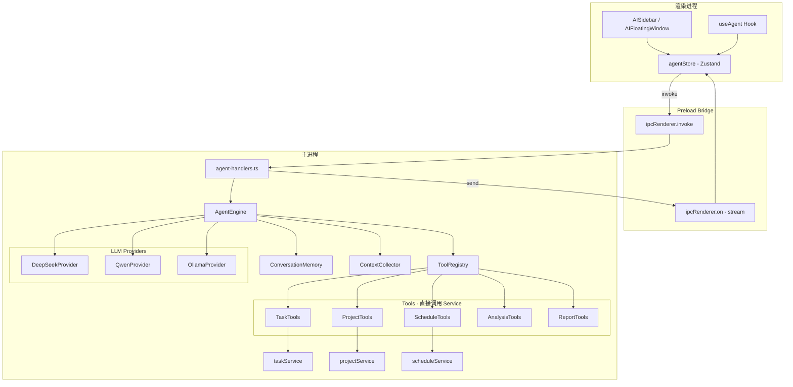

## 产品概述

在 feature/agent-integration 分支上实施 AI Agent 功能集成到 TaskHarbor 桌面应用。

## 核心功能

- **多 Provider LLM 接入**：内置轻量 Agent 引擎（DeepSeek/通义千问/Ollama）
- **自然语言任务操作**：通过对话创建/查询/修改/删除任务和项目
- **智能分析洞察**：项目进度分析、逾期风险预警、工作量分布统计
- **自动化报告生成**：自动生成日报/周报/月报
- **上下文感知助手**：Agent 自动感知当前页面/项目/任务上下文，无需重复描述
- **AI 对话侧边栏**：右侧可折叠对话面板（380px），支持流式输出和工具调用确认
- **浮动 AI 窗口**：可拖拽桌面卡片，类似 TaskReminder 的紧凑型 AI 助手
- **用户确认机制**：所有写操作（创建/修改/删除）需用户确认后执行
- **对话历史持久化**：支持多轮对话，历史存储到 SQLite 数据库

## 技术栈

- **Electron 28 + React 18 + TypeScript + Vite 5**（现有）
- **sql.js** (SQLite WASM) 本地数据库（现有）
- **Zustand + Immer** 状态管理（现有）
- **Tailwind CSS 3.4** 样式（现有）
- **lucide-react** 图标库（现有）
- **Node.js 原生 https/http** 模块调用 LLM API（不引入 langchain 等重量级框架）
- **electron-store v8.1.0** 配置持久化（已安装）
- **react-markdown + remark-gfm**（新增，用于消息 Markdown 渲染）

## 实现方案

### 整体策略

采用分阶段递进实施，每个阶段产生可独立运行验证的功能增量。先搭建主进程 Agent 引擎核心（LLM Provider + AgentEngine + ToolRegistry），再实现 IPC 桥接和前端 Store，最后实现 UI 组件和智能功能。

### 关键设计决策

**1. LLM API 调用不走 IPC，直接在主进程完成**

- Agent 工具直接调用已有 taskService/projectService/scheduleService（这些 service 是单例，在主进程直接 import）
- 只有 Agent 与渲染进程的对话需要 IPC，工具执行在主进程内完成，无额外 IPC 开销

**2. 流式输出通过 event.sender.send 实现**

- ipcMain.handle('agent:chat') 内部使用 AsyncGenerator 遍历 Agent 引擎的流式响应
- 每个 chunk 通过 event.sender.send('agent:stream', chunk) 推送到渲染进程
- 渲染进程通过 ipcRenderer.on('agent:stream', listener) 监听

**3. 工具确认机制**

- 写操作工具（create/update/delete）标记 requireConfirmation: true
- Agent 引擎检测到需要确认的工具调用时，发送 confirmation_required 类型 chunk
- 渲染进程显示确认卡片，用户点击确认/取消后通过 ipcRenderer.invoke('agent:confirmToolCall') 通知主进程
- 使用 Promise + resolve 挂起工具执行，等待用户响应后继续

**4. 对话历史存储**

- 新增 agent_conversations 和 agent_messages 两张表，遵循现有 database.ts 的建表模式
- 使用 getDatabase() 获取数据库实例，遵循 DatabaseManager 单例模式

**5. LLM Provider 可选增强**

- 通过 agentConfigService 管理连接配置
- 启动时检测 Provider 可用性，用户可在设置中切换

### 架构设计



### 实现注意事项

**性能**：

- 工具执行直接调用 service 层，不走 IPC，避免性能损耗
- 流式输出避免一次性加载完整响应到内存
- 对话历史按 conversation 分页加载

**安全**：

- API Key 通过 electron-store 加密存储，渲染进程仅看到掩码
- CSP 策略更新需同时覆盖 dev 和 production 环境
- contextIsolation: true 保持不变，所有通信走 IPC

**向后兼容**：

- 不修改现有 IPC 通道签名，新增 agent: 前缀通道
- 不修改现有数据库表结构，仅新增表
- 不修改现有组件结构，AISidebar 作为独立组件嵌入 Layout

**错误处理**：

- LLM API 调用失败时提供清晰错误信息和建议
- 网络超时默认 60 秒，支持 AbortController 取消
- 工具执行失败信息反馈给 LLM 让其自动重试或换方案

## 目录结构

```
e:\AZE-BlackCore\TaskHarbor\

### 新增文件

main/src/
  agent/
    index.ts                        # [NEW] Agent 模块入口，导出 setupAgentHandlers()
    LLMProvider.ts                  # [NEW] LLM 提供者抽象接口 + DeepSeek/Qwen/Ollama 三个实现
    AgentEngine.ts                  # [NEW] Agent 引擎核心：对话循环、工具调用、流式输出
    ToolRegistry.ts                 # [NEW] 工具注册表：定义、注册、执行、确认机制
    ConversationMemory.ts           # [NEW] 对话记忆管理：SQLite 持久化、多轮上下文
    ContextCollector.ts             # [NEW] 上下文收集器：页面/项目/任务上下文感知
    tools/
      TaskTools.ts                  # [NEW] 任务 CRUD 工具（直接调用 taskService）
      ProjectTools.ts               # [NEW] 项目管理工具（直接调用 projectService）
      ScheduleTools.ts              # [NEW] 日程管理工具（直接调用 scheduleService）
      AnalysisTools.ts              # [NEW] 数据分析工具（统计/趋势/风险预警）
      ReportTools.ts                # [NEW] 报告生成工具（日报/周报/月报）
    prompts/
      systemPrompt.ts               # [NEW] 系统提示词模板（TaskHarbor AI 助手角色定义）
      taskPrompt.ts                 # [NEW] 任务操作相关提示词
      analysisPrompt.ts             # [NEW] 分析洞察相关提示词
      reportPrompt.ts               # [NEW] 报告生成相关提示词
  ipc-handlers/
    agent-handlers.ts               # [NEW] Agent IPC 处理器（流式对话、确认、配置、历史）
  services/
    agentConfigService.ts           # [NEW] Agent 配置持久化（electron-store）

renderer/src/
  types/
    agent.ts                        # [NEW] Agent 相关 TypeScript 类型定义
  stores/
    agentStore.ts                   # [NEW] Agent 状态管理（Zustand + Immer）
  hooks/
    useAgent.ts                     # [NEW] Agent 交互 Hook（发送消息、监听流、确认工具）
  components/
    agent/
      AISidebar.tsx                 # [NEW] 右侧 AI 对话侧边栏（可折叠 380px）
      ChatMessage.tsx               # [NEW] 聊天消息气泡组件（Markdown 渲染）
      ChatInput.tsx                 # [NEW] 聊天输入框（支持快捷操作）
      ContextBadge.tsx              # [NEW] 上下文感知标签显示
      QuickActions.tsx              # [NEW] 快捷操作面板（创建任务/查询进度/生成报告）
      ToolResult.tsx                # [NEW] 工具执行结果展示卡片
      ToolConfirmation.tsx          # [NEW] 工具调用确认对话框
      StreamingText.tsx             # [NEW] 流式文本渲染组件
      AIFloatingWindow.tsx          # [NEW] 浮动 AI 助手窗口
    settings/
      AISettings.tsx                # [NEW] AI 设置面板（LLM Provider/API Key 配置）

### 修改文件

main/src/
  index.ts                          # [MODIFY] 导入并调用 setupAgentHandlers()、更新 CSP connect-src
  services/database.ts              # [MODIFY] 新增 agent_conversations 和 agent_messages 建表语句

preload/src/
  index.ts                          # [MODIFY] 新增 agent 相关 IPC API 暴露

renderer/src/
  vite-env.d.ts                     # [MODIFY] ElectronAPI 接口新增 Agent 方法类型定义
  App.tsx                           # [MODIFY] 添加 AIFloatingWindow 全局组件
  components/Layout.tsx             # [MODIFY] 在 main 区域末尾添加 AISidebar
  components/settings/SettingsPanel.tsx  # [MODIFY] 添加 AI 设置 Tab 入口

package.json (renderer)             # [MODIFY] 新增 react-markdown、remark-gfm 依赖
```

## 关键代码结构

### LLMProvider 接口

```typescript
// main/src/agent/LLMProvider.ts
interface LLMConfig {
  provider: 'deepseek' | 'qwen' | 'ollama';
  apiKey?: string;
  baseUrl?: string;
  model: string;
  temperature?: number;
  maxTokens?: number;
}

interface LLMMessage {
  role: 'system' | 'user' | 'assistant' | 'tool';
  content: string;
  toolCalls?: ToolCall[];
  toolCallId?: string;
}

interface LLMResponse {
  content: string;
  toolCalls?: ToolCall[];
  finishReason: 'stop' | 'tool_calls' | 'length';
}

interface LLMProvider {
  chat(messages: LLMMessage[], tools?: ToolDefinition[]): AsyncGenerator<LLMResponse>;
  isAvailable(): Promise<boolean>;
  getModelName(): string;
}
```

### Agent 流式响应协议

```typescript
// 流式 chunk 类型（IPC 传输）
type AgentStreamChunk =
  | { type: 'text'; content: string; conversationId: string }
  | { type: 'tool_call'; toolName: string; toolArgs: any; toolCallId: string }
  | { type: 'tool_result'; toolName: string; toolResult: any; toolCallId: string }
  | { type: 'confirmation_required'; toolName: string; toolArgs: any; toolCallId: string; description: string }
  | { type: 'error'; content: string }
  | { type: 'done'; conversationId: string }
```

## Agent Extensions

### SubAgent

- **code-explorer**
- Purpose: 在实施过程中探索代码库中需要修改的具体位置（如现有 service 方法签名、组件 props 结构等）
- Expected outcome: 精确定位修改目标，避免盲目修改导致回归错误