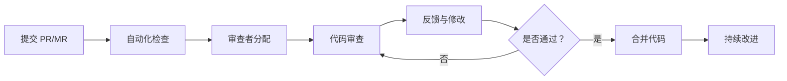

# TaskHarbor 代码审查标准与流程

> 📋 **建立系统性代码审查机制，提升代码质量和团队工程能力**

## 📖 目录

1. [审查目标与原则](#审查目标与原则)
2. [审查流程](#审查流程)
3. [审查标准](#审查标准)
4. [检查清单](#检查清单)
5. [审查模板](#审查模板)
6. [自动化配置](#自动化配置)

---

## 🎯 审查目标与原则

### 核心目标

1. **确保正确性** - 代码按预期工作，无逻辑错误
2. **提升安全性** - 识别并修复安全漏洞
3. **增强可维护性** - 代码易读、易理解、易修改
4. **优化性能** - 避免性能瓶颈和资源浪费
5. **知识共享** - 通过审查促进团队技术交流

### 审查原则

✅ **建设性反馈** - 对事不对人，关注代码而非作者  
✅ **具体明确** - 指出具体行号和问题，提供改进建议  
✅ **优先级分明** - 区分阻塞性问题和建议性优化  
✅ **平衡质量与效率** - 不过度审查，关注重要问题  
✅ **教导而非批评** - 解释为什么，帮助团队成长

---

## 🔄 审查流程

### 完整审查工作流



### 详细步骤

#### 1️⃣ 提交前准备（开发者）

**提交代码前，确保完成以下检查：**

- [ ] 代码能在本地正常运行
- [ ] 已通过所有自动化测试（`npm test`）
- [ ] 已通过类型检查（`npm run typecheck:all`）
- [ ] 已通过 Lint 检查（`npm run lint`）
- [ ] 代码格式已统一（`prettier --write`）
- [ ] 提交了清晰的 commit message（遵循 Conventional Commits）
- [ ] 更新了相关文档（如适用）

#### 2️⃣ 创建 Pull Request

**PR 描述模板：**

```markdown
## 📝 变更说明
- 修复了什么问题 / 新增了什么功能
- 为什么需要这些变更

## 🔗 关联 Issue
- Closes #123

## 🧪 测试
- [ ] 已测试核心功能
- [ ] 已添加/更新单元测试
- [ ] 已在开发环境验证

## 📸 截图（如适用）
[上传截图]

## ✅ 自查清单
- [ ] 代码遵循项目规范
- [ ] 无 console.log 等调试代码
- [ ] 已处理边界情况
- [ ] 已更新类型定义
```

#### 3️⃣ 自动化检查（CI）

**自动执行的检查项：**

1. **类型检查** - `npm run typecheck:all`
2. **Lint 检查** - `npm run lint`
3. **单元测试** - `npm test`
4. **构建验证** - `npm run build:all`

#### 4️⃣ 人工审查（审查者）

**审查时机：** 收到审查通知后 **24 小时内** 完成

**审查重点：**

- 🔴 **阻塞性问题** - 必须修复才能合并
- 🟡 **建议性改进** - 应该修复，可协商
- 💭 **优化建议** - 最好有，非必需

#### 5️⃣ 反馈与修改

**审查评论格式：**

```
🔴 **安全：SQL 注入风险**
第 42 行：用户输入直接插入到查询中。

**为什么：** 攻击者可以注入 `'; DROP TABLE users; --` 作为 name 参数。

**建议：**
- 使用参数化查询：`db.query('SELECT * FROM users WHERE name = $1', [name])`
```

**开发者响应：**

- 对每个评论进行回复（已修复/说明原因/提出问题）
- 提交修改后标记"已解决"
- 如有疑问，主动约审查者讨论

#### 6️⃣ 合并代码

**合并条件：**

- ✅ 所有自动化检查通过
- ✅ 至少 1 名审查者批准
- ✅ 所有阻塞性问题已解决
- ✅ PR 描述完整清晰

**合并方式：**

- 优先使用 **Squash and Merge**（保持主分支历史清晰）
- 保留重要 commit 的历史记录时使用 **Merge Commit**
- 避免使用 **Rebase and Merge**（除非有特殊需求）

---

## 📐 审查标准

### 🔴 阻塞性问题（必须修复）

#### 1. 安全性问题

**Electron 特有：**

- ❌ `nodeIntegration: true`（渲染进程中启用 Node.js）
- ❌ `webSecurity: false`（关闭 Web 安全策略）无充分理由
- ❌ 直接加载远程代码（`<script src="https://...">`）
- ❌ 未验证的 IPC 消息处理
- ❌ 敏感信息硬编码在代码中

**通用安全：**

- ❌ SQL 注入风险（直接拼接 SQL 字符串）
- ❌ XSS 攻击风险（未转义的用户输入）
- ❌ 路径遍历漏洞（未验证的文件路径）
- ❌ 未授权的 API 访问

**示例（❌ 错误）：**

```typescript
// ❌ 危险：直接拼接 SQL
db.run(`SELECT * FROM tasks WHERE id = '${taskId}'`);

// ❌ 危险：渲染进程启用 Node
webPreferences: {
  nodeIntegration: true,
  contextIsolation: false
}
```

**示例（✅ 正确）：**

```typescript
// ✅ 安全：参数化查询
db.run('SELECT * FROM tasks WHERE id = ?', [taskId]);

// ✅ 安全：禁用 Node 集成，启用上下文隔离
webPreferences: {
  nodeIntegration: false,
  contextIsolation: true,
  preload: path.join(__dirname, 'preload.js')
}
```

#### 2. 数据完整性问题

- ❌ 缺少事务处理的多步骤数据库操作
- ❌ 未处理外键约束的级联删除
- ❌ 缺少必要的数据验证
- ❌ 竞态条件导致的数据不一致

#### 3. 关键路径错误处理

- ❌ 未捕获的 Promise rejection
- ❌ 缺少 try-catch 的关键操作
- ❌ 吞掉错误（空的 catch 块）
- ❌ 未检查 API 调用返回值

**示例（❌ 错误）：**

```typescript
// ❌ 危险：未处理错误
async function loadTask(id: string) {
  const result = await ipcRenderer.invoke('load-task', id);
  return result; // 如果失败了呢？
}

// ❌ 危险：吞掉错误
try {
  await riskyOperation();
} catch (e) {
  // 空 catch
}
```

**示例（✅ 正确）：**

```typescript
// ✅ 安全：完整错误处理
async function loadTask(id: string) {
  try {
    const result = await ipcRenderer.invoke('load-task', id);
    if (!result) {
      throw new Error(`Task ${id} not found`);
    }
    return result;
  } catch (error) {
    console.error('[Task] Failed to load:', error);
    errorStore.addError('加载任务失败', 'error');
    throw error;
  }
}
```

#### 4. 破坏性变更

- ❌ 未保持向后兼容的 API 修改
- ❌ 删除已公开的类型/接口
- ❌ 修改数据库结构无迁移脚本

---

### 🟡 建议性问题（应该修复）

#### 1. 代码可维护性

**命名问题：**

- ⚠️ 不清晰的变量名（`data`, `temp`, `item`）
- ⚠️ 命名与实际用途不符
- ⚠️ 混用中英文命名

**函数设计：**

- ⚠️ 函数过长（> 50 行）
- ⚠️ 单一职责原则违反（一个函数做多件事）
- ⚠️ 参数过多（> 3 个参数）

**示例（⚠️ 需改进）：**

```typescript
// ⚠️ 函数太长，职责不单一
function handleTask(data: any) {
  // 100 行代码...
  // 验证数据
  // 保存到数据库
  // 发送通知
  // 更新统计
  // 记录日志
}
```

**示例（✅ 改进后）：**

```typescript
// ✅ 职责单一，易于理解
async function handleTask(data: TaskData) {
  const validated = validateTaskData(data);
  const task = await saveTaskToDatabase(validated);
  await sendNotification(task);
  updateStatistics(task);
  logActivity('task_created', task);
}
```

#### 2. 类型安全

- ⚠️ 滥用 `any` 类型
- ⚠️ 缺少返回类型注解
- ⚠️ 未定义的接口/类型
- ⚠️ 类型断言滥用（`as any`）

**示例（⚠️ 需改进）：**

```typescript
// ⚠️ 滥用 any
function process(data: any): any {
  return data.result;
}
```

**示例（✅ 正确）：**

```typescript
// ✅ 明确类型
interface ProcessResult {
  result: string;
  success: boolean;
}

function process(input: InputData): ProcessResult {
  return {
    result: 'done',
    success: true
  };
}
```

#### 3. React 最佳实践

- ⚠️ useEffect 依赖项不完整
- ⚠️ 不必要的重渲染
- ⚠️ 缺少 key 或 key 不正确
- ⚠️ 在渲染中创建对象/函数

**示例（⚠️ 需改进）：**

```typescript
// ⚠️ 依赖项缺失
useEffect(() => {
  fetchData(userId);
}, []); // 缺少 userId

// ⚠️ 渲染中创建新对象
<List items={data.map(item => ({ ...item, selected: false }))} />
```

**示例（✅ 正确）：**

```typescript
// ✅ 完整依赖项
useEffect(() => {
  if (userId) {
    fetchData(userId);
  }
}, [userId]);

// ✅ 使用 useMemo 缓存
const processedItems = useMemo(
  () => data.map(item => ({ ...item, selected: false })),
  [data]
);
```

#### 4. 性能优化

- ⚠️ 大列表无虚拟滚动
- ⚠️ 重复的 API 调用
- ⚠️ 未清理的定时器/订阅
- ⚠️ 内存泄漏风险

---

### 💭 优化建议（最好有）

#### 1. 代码风格

- 💭 注释不足或过度注释
- 💭 代码格式不一致
- 💭 导入顺序混乱

#### 2. 文档完善

- 💭 缺少 JSDoc 注释
- 💭 复杂逻辑无说明
- 💭 README 未更新

#### 3. 测试覆盖

- 💭 边界情况缺少测试
- 💭 集成测试不足
- 💭 缺少错误场景测试

---

## ✅ 检查清单

### 通用检查清单

#### 代码质量

- [ ] 代码逻辑正确，无明显的 bug
- [ ] 错误处理完整，无未捕获的异常
- [ ] 边界情况已处理（空值、null、undefined）
- [ ] 无 console.log 等调试代码（生产环境）
- [ ] 无死代码和未使用的变量

#### 安全性

- [ ] 用户输入已验证和转义
- [ ] 数据库查询使用参数化
- [ ] 敏感信息未硬编码
- [ ] IPC 通信已验证消息来源
- [ ] 文件操作已验证路径

#### 可维护性

- [ ] 命名清晰表意
- [ ] 函数职责单一
- [ ] 代码有适当注释
- [ ] 复杂逻辑有说明
- [ ] 遵循项目代码规范

#### 性能

- [ ] 无明显的性能瓶颈
- [ ] 大列表使用虚拟滚动
- [ ] 定时器和订阅已清理
- [ ] 无内存泄漏风险
- [ ] 避免不必要的重渲染

#### 类型安全

- [ ] 无 `any` 类型滥用
- [ ] 函数有返回类型
- [ ] 接口定义完整
- [ ] 类型断言合理

### Electron 特有检查清单

#### 主进程（main）

- [ ] `nodeIntegration: false`
- [ ] `contextIsolation: true`
- [ ] 设置了 `preload` 脚本
- [ ] IPC 处理器验证输入
- [ ] 文件操作验证路径
- [ ] 未禁用 `webSecurity`（除非必要）
- [ ] CSP 策略配置正确

#### 渲染进程（renderer）

- [ ] 通过 preload 暴露 API
- [ ] 未直接使用 Node.js API
- [ ] 用户输入转义处理
- [ ] 外部链接安全验证
- [ ] 敏感操作需用户确认

#### Preload 脚本

- [ ] 使用 `contextBridge` 暴露 API
- [ ] 仅暴露必要的 API
- [ ] 输入参数验证
- [ ] 无直接 DOM 操作

### React 特有检查清单

#### 组件设计

- [ ] 组件职责单一
- [ ] Props 类型定义完整
- [ ] 状态管理合理
- [ ] 避免 prop drilling（使用 Context/Zustand）

#### Hooks 使用

- [ ] useEffect 依赖项完整
- [ ] 自定义 Hooks 提取合理
- [ ] 无规则违反（条件调用等）
- [ ] 清理函数完整

#### 性能优化

- [ ] 使用 React.memo 避免不必要渲染
- [ ] 使用 useMemo/useCallback 优化计算
- [ ] 大列表使用虚拟滚动
- [ ] 图片等资源懒加载

---

## 📝 审查模板

### PR 审查评论模板

```markdown
## 📊 审查总结

**整体印象：** [积极/中性/需改进]

**优点：**
- [列出代码中的亮点]

**关键关注点：**
- [列出需要重点关注的问题]

---

## 🔴 阻塞性问题（必须修复）

### 1. [问题标题]

**位置：** 文件路径：行号

**问题描述：**
[详细描述问题]

**为什么这是个问题：**
[解释原因和可能的后果]

**建议修复：**
[提供具体的修复建议或代码示例]

---

## 🟡 建议性问题（应该修复）

### 1. [问题标题]

**位置：** 文件路径：行号

**问题描述：**
[详细描述问题]

**建议：**
[提供改进建议]

---

## 💭 优化建议（可选）

### 1. [优化建议]

**位置：** 文件路径：行号

**建议：**
[提供优化思路]

---

## ✅ 做得好的地方

- [具体表扬的代码片段]
- [巧妙的解决方案]
- [清晰的代码结构]

---

## 📋 后续步骤

1. [ ] 修复阻塞性问题
2. [ ] 考虑建议性改进
3. [ ] 更新相关文档
4. [ ] 补充测试用例

**审查者：** [姓名]  
**审查时间：** [日期]
```

### 快速审查清单（简化版）

```markdown
## 快速审查检查

### 安全性
- [ ] 无 SQL 注入风险
- [ ] 无 XSS 攻击风险
- [ ] IPC 通信安全
- [ ] 敏感信息未硬编码

### 正确性
- [ ] 逻辑正确
- [ ] 错误处理完整
- [ ] 边界情况处理

### 可维护性
- [ ] 命名清晰
- [ ] 函数简洁
- [ ] 代码易读

### 性能
- [ ] 无明显瓶颈
- [ ] 内存管理正确
- [ ] 无泄漏风险

### 类型安全
- [ ] 无 any 滥用
- [ ] 类型定义完整

**审查结果：** ✅ 通过 / 🟡 需修改 / 🔴 拒绝
```

---

## 🤖 自动化配置

### ESLint 配置增强

在 `renderer/eslint.config.js` 中添加更严格的规则：

```javascript
import js from '@eslint/js'
import globals from 'globals'
import reactHooks from 'eslint-plugin-react-hooks'
import reactRefresh from 'eslint-plugin-react-refresh'
import tseslint from 'typescript-eslint'
import eslintPluginSecurity from 'eslint-plugin-security'

export default tseslint.config(
  { ignores: ['dist', 'node_modules'] },
  {
    extends: [
      js.configs.recommended,
      ...tseslint.configs.recommended,
      ...tseslint.configs.stylistic,
    ],
    files: ['**/*.{ts,tsx}'],
    languageOptions: {
      ecmaVersion: 2020,
      globals: globals.browser,
    },
    plugins: {
      'react-hooks': reactHooks,
      'react-refresh': reactRefresh,
      security: eslintPluginSecurity,
    },
    rules: {
      // React Hooks 规则
      ...reactHooks.configs.recommended.rules,
      'react-refresh/only-export-components': [
        'warn',
        { allowConstantExport: true },
      ],
      
      // TypeScript 严格规则
      '@typescript-eslint/no-explicit-any': 'error',
      '@typescript-eslint/no-unused-vars': ['error', { argsIgnorePattern: '^_' }],
      '@typescript-eslint/explicit-function-return-type': 'warn',
      '@typescript-eslint/no-non-null-assertion': 'warn',
      
      // 安全规则
      'security/detect-non-literal-fs-filename': 'warn',
      'security/detect-object-injection': 'warn',
      
      // 代码质量规则
      'no-console': ['warn', { allow: ['warn', 'error'] }],
      'no-debugger': 'error',
      'prefer-const': 'error',
      'no-var': 'error',
    },
  },
)
```

### Husky + lint-staged 配置

**安装依赖：**

```bash
npm install -D husky lint-staged
```

**配置 Husky：**

```bash
npx husky init
```

**编辑 `.husky/pre-commit`：**

```bash
#!/usr/bin/env sh
. "$(dirname -- "$0")/_/husky.sh"

npx lint-staged
```

**配置 `package.json`：**

```json
{
  "lint-staged": {
    "*.{ts,tsx}": [
      "eslint --fix",
      "prettier --write"
    ],
    "*.{json,md}": [
      "prettier --write"
    ]
  }
}
```

### GitHub Actions CI 配置

创建 `.github/workflows/code-review.yml`：

```yaml
name: Code Review

on:
  pull_request:
    branches: [main, develop]

jobs:
  quality-check:
    runs-on: windows-latest
    
    steps:
      - uses: actions/checkout@v4
      
      - name: Setup Node.js
        uses: actions/setup-node@v4
        with:
          node-version: '20'
          cache: 'npm'
      
      - name: Install dependencies
        run: npm ci
      
      - name: Type check
        run: npm run typecheck:all
      
      - name: Lint
        run: npm run lint
      
      - name: Test
        run: npm test
      
      - name: Build
        run: npm run build:all
```

---

## 📚 附录

### 推荐工具

#### 代码质量

- **ESLint** - JavaScript/TypeScript Lint
- **Prettier** - 代码格式化
- **TypeScript** - 静态类型检查
- **SonarQube** - 代码质量平台

#### 安全扫描

- **npm audit** - 依赖安全审计
- **Snyk** - 安全漏洞扫描
- **eslint-plugin-security** - 安全规则检查

#### 性能分析

- **Chrome DevTools** - 性能分析
- **React DevTools** - 组件性能
- **Webpack Bundle Analyzer** - 包大小分析

### 学习资源

- [Electron 安全最佳实践](https://www.electronjs.org/docs/latest/tutorial/security)
- [React 性能优化](https://react.dev/learn/render-and-commit)
- [TypeScript 深度指南](https://www.typescriptlang.org/docs/)
- [Clean Code 代码整洁之道](https://book.douban.com/subject/30468597/)

### 审查指标追踪

**建议追踪以下指标：**

- 平均审查时间（从提交到合并）
- 每个 PR 的平均评论数
- 阻塞性问题发现率
- 代码审查覆盖率
- 审查后 bug 率

---

## 🎯 持续改进

代码审查不是一次性工作，而是持续改进的过程：

1. **定期回顾** - 每月回顾审查中发现的高频问题
2. **更新标准** - 根据团队成长调整审查标准
3. **分享学习** - 将典型问题整理为团队知识库
4. **工具优化** - 用自动化替代人工检查重复问题
5. **文化建设** - 营造开放、学习、成长的审查文化

---

**文档版本：** 1.0.0  
**创建日期：** 2026-04-09  
**最后更新：** 2026-04-09  
**维护者：** TaskHarbor 开发团队
